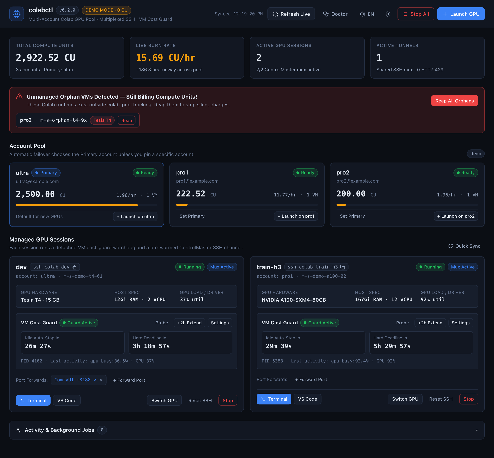
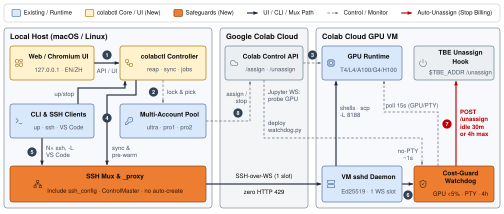
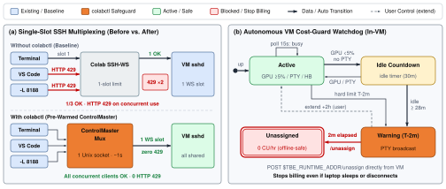
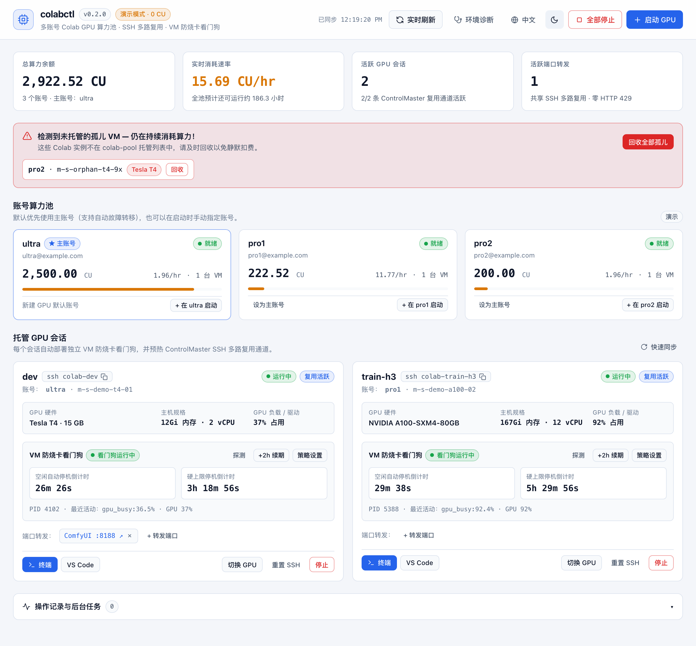
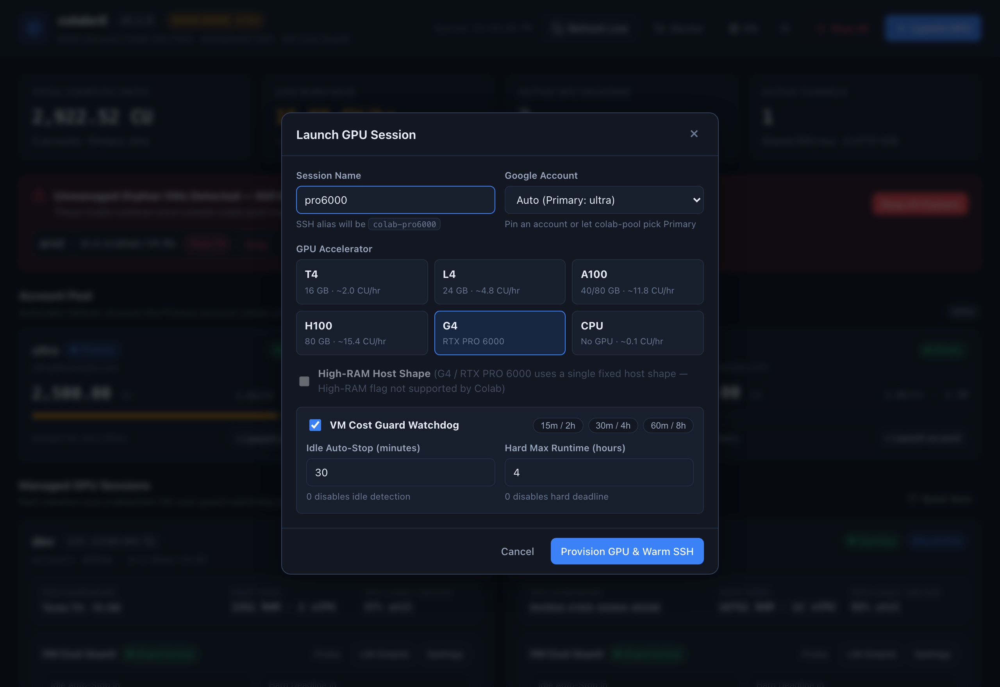

<div align="center">

# colabctl

**Turn Multi-Account Google Colab GPUs into Multiplexed SSH Workstations — with Zero `HTTP 429` & Autonomous Cost Protection**

[](pyproject.toml)
[](src/colabctl/__init__.py)
[](#local-management-dashboard-colabctl-ui)
[](README.zh-CN.md)
[](#development--testing)

**English** | [简体中文](README.zh-CN.md)

</div>

---

`colabctl` is an automated **multi-account Google Colab GPU controller, multiplexed SSH manager, VM-side anti-burn watchdog, and local Chromium App / Web dashboard** built on top of Google's official [`google-colab-cli`](https://github.com/googlecolab/google-colab-cli) and [`colab-account-changer`](https://github.com/mizorewww/colab-account-changer).

Stop juggling Colab browser tabs, fighting `HTTP 429` SSH lockouts, patching fragile `cloudflared` / `ngrok` tunnels, or waking up to drained Compute Units because your laptop went to sleep. With `colabctl`, spinning up a **T4, L4, A100, H100, or RTX PRO 6000 (G4)** takes one command — or one click.

<div align="center">
  
  <br />
  <sub><b>colabctl Local Control Plane</b> — Multi-account Compute Unit pool, orphan VM billing alerts, live VM watchdog countdowns, and shared-channel port forwarding. Try it safely with <code>colabctl ui --demo</code> (0 CU spent).</sub>
</div>

---

## Why `colabctl`?

| Capability | Colab Web UI | Raw `google-colab-cli` | **`colabctl`** |
| :--- | :---: | :---: | :---: |
| Browser-free GPU provisioning (`T4` / `L4` / `A100` / `H100` / `G4`) | ❌ | ✅ | ✅ |
| Multi-account CU pooling, balance tracking & automatic failover | ❌ | ❌ | ✅ |
| Concurrent terminals + VS Code Remote-SSH + `-L` port forwards | ❌ | ❌ *(hits `HTTP 429`)* | ✅ *(1 pre-warmed `ControlMaster`)* |
| Auto-stop idle/forgotten GPU **even when laptop sleeps or loses Wi-Fi** | ❌ *(browser dependent)* | ❌ | ✅ *(in-VM `$TBE_ADDR/unassign`)* |
| Hard max-runtime cap + terminal warning + `+2h` one-click extend | ❌ | ❌ | ✅ |
| Auto-reap newly leaked orphan VMs after 503 / timeout *(keeps browser VMs safe)* | ❌ | ❌ | ✅ |
| Prevent `ssh` from silently creating a new paid VM after stop | — | ❌ | ✅ *(`colabctl _proxy` guard)* |
| Single-shape GPU (`G4` / `L4`) `High-RAM` `HTTP 400` prevention | — | Partial *(L4 only)* | ✅ *(G4 & L4 protected)* |
| Local Chromium App / Web Dashboard (`EN / 简体中文`, Dark/Light, `--demo`) | — | ❌ | ✅ |
| Machine-readable `--json` CLI for scripts & AI coding agents | ❌ | Partial | ✅ |

---

## Architecture & Core Mechanisms

### Full-Stack Architecture

`colabctl` cleanly separates its UI-agnostic core controller ([`service.py`](src/colabctl/service.py)) from both its CLI ([`cli.py`](src/colabctl/cli.py)) and loopback-only Web Dashboard ([`web/server.py`](src/colabctl/web/server.py)). Every action flows through one shared orchestration layer:

<div align="center">
  
  <br />
  <sub><b>Figure 1.</b> Full-stack architecture and end-to-end workflow of <code>colabctl</code>. Source exports: <a href="docs/figures/colabctl-workflow/fig.final.svg">SVG</a> · <a href="docs/figures/colabctl-workflow/fig.final.pdf">PDF</a> · <a href="docs/figures/colabctl-workflow/fig.png">PNG</a>.</sub>
</div>

### How the Two Core Safeguards Work

Google Colab's native SSH-over-WebSocket relay allows only **one concurrent SSH slot per VM** (rejecting additional connections with `HTTP 429`), and any idle VM left behind after a laptop lid closes silently drains paid Compute Units. `colabctl` solves both at the protocol and VM levels:

<div align="center">
  
  <br />
  <sub><b>Figure 2.</b> Core safeguards of <code>colabctl</code>. <b>(a)</b> Pre-warming one OpenSSH <code>ControlMaster</code> Unix socket multiplexes terminals, VS Code Remote-SSH, <code>-L</code> tunnels, and fast no-PTY probes over Colab's single slot with zero <code>HTTP 429</code>. <b>(b)</b> Inside the VM, a detached Python stdlib watchdog polls GPU utilization (&lt;5%), PTY I/O, and hard runtime caps, broadcasting a 2-minute warning before autonomously calling <code>$TBE_RUNTIME_ADDR/unassign</code> even offline. Exports: <a href="docs/figures/colabctl-mechanisms/fig.final.svg">SVG</a> · <a href="docs/figures/colabctl-mechanisms/fig.final.pdf">PDF</a> · <a href="docs/figures/colabctl-mechanisms/fig.png">PNG</a>.</sub>
</div>

### Four-Layer Anti-Burn Protection

1. **Autonomous VM-Side Idle Watchdog** *(default: 30 min)* — A detached zero-dependency Python daemon runs *inside* the Colab VM, polling `nvidia-smi` utilization (`< 5%`), `/dev/pts/*` terminal I/O mtime, and heartbeats every 15s. When idle expires, it calls `$TBE_RUNTIME_ADDR/unassign` directly from inside the VM — **still works if your laptop is asleep or offline**.
2. **Hard Max-Runtime Cap** *(default: 4 hrs)* — Even if a training script hangs at 100% GPU utilization, the watchdog broadcasts a 2-minute warning to all active terminals and releases the VM at the deadline unless extended (`colabctl extend <name> --hours 2` or `+2h Extend` in the UI).
3. **No Implicit VM Creation on `ssh`** — `colabctl` writes managed host blocks to `~/.config/colabctl/ssh_config` (non-invasively `Include`d at the top of `~/.ssh/config`) routed through `colabctl _proxy`, which refuses to silently spin up a paid VM if you reconnect to a stopped alias.
4. **Surgical Orphan Diff-Reaping** — If `colabctl up` fails on an upstream timeout or `HTTP 503`, `colabctl` diffs server assignments before and after the attempt and reaps *only* the newly leaked orphan VM — never touching notebooks you opened manually in the browser.

---

## Local Management Dashboard (`colabctl ui`)

Launch a standalone native-feeling desktop window (via your installed Chrome, Edge, Brave, Arc, or Chromium `--app` mode) or a regular browser tab — with **zero external CDN dependencies** (works completely offline):

```bash
# Launch standalone Chromium App window (connects to your real account pool)
colabctl ui

# Zero-CU safe preview mode (in-memory mock data — no Google login or Compute Units needed!)
colabctl ui --demo

# Launch directly in Simplified Chinese or English (defaults to auto-detect + saved toggle)
colabctl ui --lang zh
colabctl ui --lang en

# Open in default browser tab, or run headless local server only
colabctl ui --browser
colabctl ui --no-open --port 18420
```

<table>
  <tr>
    <td width="50%">
      
      <p align="center"><sub><b>Bilingual (EN / 简体中文) & Light / Dark Themes</b> — Instant client-side switching with persistent preferences, live 1-second watchdog countdowns, and one-click orphan reaping.</sub></p>
    </td>
    <td width="50%">
      
      <p align="center"><sub><b>Smart GPU Provisioning Modal</b> — Pick T4 / L4 / A100 / H100 / G4 (RTX PRO 6000) / CPU, pin accounts, configure watchdog presets, and automatically guard single-shape GPUs against <code>HTTP 400</code>.</sub></p>
    </td>
  </tr>
</table>

**Dashboard Highlights:**
- **One-Click Native Workflows**: Open macOS iTerm2 / Terminal.app directly into the VM, jump straight into **VS Code Remote-SSH** (`/content`), copy `ssh colab-<name>`, or recover from stale SSH sessions with **Reset SSH**.
- **Visual `-L` Port Forwarding**: Built-in presets for **ComfyUI (`8188`)**, **TensorBoard (`6006`)**, **Gradio (`7860`)**, **vLLM / API (`8000`)**, and **Jupyter (`8888`)** — multiplexed over the existing `ControlMaster` socket with automatic protection against Colab's reserved port `8080`.
- **Local-First Security Boundary**: Binds strictly to `127.0.0.1`, enforces loopback-only `Host` headers (blocks DNS rebinding), requires a per-launch random Session Token (`X-Colabctl-Token` + `HttpOnly SameSite=Strict` cookie, stripped from the URL on load), and detects backend exits/restarts with a live disconnect banner instead of spinning silently.

---

## Quick Start

### 1. Install Prerequisites & Add Google Accounts

> Requires Python 3.12+ and [`uv`](https://docs.astral.sh/uv/) (recommended).

```bash
# Install Google's official Colab CLI and multi-account pool manager
uv tool install "google-colab-cli>=0.8.0"
uv tool install "git+https://github.com/mizorewww/colab-account-changer"

# Add one or more Google Colab accounts (stored securely in your OS Keychain)
colab-account add ultra
colab-account add pro1
colab-account list --usage
```

### 2. Install `colabctl`

```bash
git clone https://github.com/yunzinan/colabctl.git
cd colabctl
uv tool install -e .

# Verify dependencies, SSH key, ~/.ssh/config Include, and account pool
colabctl doctor
```

> If you don't have an Ed25519 SSH key yet, generate one with:
> `ssh-keygen -t ed25519 -f ~/.ssh/id_ed25519_colab`

### 3. Launch Your First GPU

```bash
# Option A: Open the visual Chromium App dashboard
colabctl ui

# Option B: Provision a T4 via CLI (30m idle auto-stop, 4h hard cap, warm SSH mux)
colabctl up dev --gpu t4

# Connect from as many terminals / VS Code windows as you want — zero HTTP 429
ssh colab-dev
```

---

## Supported Accelerators

| `--gpu` Flag | Hardware | Typical VRAM | High-RAM (`--high-mem`) |
| :--- | :--- | :--- | :--- |
| `t4` | NVIDIA Tesla T4 | 16 GB | Supported |
| `l4` | NVIDIA L4 | 24 GB | Single fixed shape *(auto-ignored)* |
| `a100` | NVIDIA A100 | 40 / 80 GB | Supported *(host RAM; VRAM depends on Colab allocation)* |
| `h100` | NVIDIA H100 | 80 GB | Supported |
| `g4` | NVIDIA RTX PRO 6000 Blackwell | 96 GB | Single fixed shape *(auto-stripped to prevent Colab `HTTP 400`)* |
| `none` | CPU-only Runtime | — | Supported |

---

## CLI Command Reference

All inspection and lifecycle commands support `--json` for scripting and AI agent automation.

```bash
# --- Diagnostics & Pool Overview ---
colabctl doctor                                  # Check binaries, SSH key, config Include, accounts
colabctl ls                                      # Cached pool overview + sessions + orphan alerts
colabctl ls --live --probe-guard                 # Live Google CU balances + live VM watchdog timers
colabctl primary ultra --threshold 5             # Set primary failover account

# --- Provisioning & GPU Switching ---
colabctl up dev --gpu t4                         # Default: T4, 30m idle guard, 4h hard cap
colabctl up pro6k --gpu g4 --account ultra       # Launch RTX PRO 6000 on a pinned account
colabctl up train --gpu a100 --high-mem --max-hours 8 --connect
colabctl switch dev --gpu l4                     # Stop old VM & re-provision under same SSH alias

# --- Multiplexed SSH & Port Forwarding (Zero HTTP 429) ---
ssh colab-dev                                    # Native OpenSSH via pre-warmed ControlMaster
colabctl ssh dev                                 # Interactive shell wrapper
colabctl ssh dev -- nvidia-smi                   # Run a one-shot remote command
colabctl tunnel dev 8188                         # Forward VM :8188 -> 127.0.0.1:8188 (e.g. ComfyUI)
colabctl mount-drive dev                         # Mount Google Drive inside the VM

# --- VM Cost Guard & Recovery ---
colabctl status dev                              # Hardware spec + live watchdog countdown + GPU util
colabctl extend dev --hours 2                    # Extend hard deadline by +2h & reset idle timer
colabctl guard dev --idle-min 60 --max-hours 8   # Adjust watchdog thresholds live
colabctl guard dev --off                         # Pause auto-stop watchdog
colabctl guard dev --on                          # Re-enable watchdog
colabctl reset-ssh dev                           # Clear orphaned remote sshd sessions & re-warm mux

# --- Teardown & Orphan Cleanup ---
colabctl stop dev                                # Stop VM, halt billing, remove SSH alias
colabctl stop --all                              # Terminate ALL VMs and orphans across every account
colabctl reap --all-orphans                      # Reap unmanaged orphan VMs still billing CU

# --- Local Web / Chromium Dashboard ---
colabctl ui                                      # Standalone Chromium App window
colabctl ui --demo                               # Zero-CU safe demo mode
colabctl ui --lang zh                            # Force initial language (auto | zh | en)
```

---

## Development & Testing

```bash
# Run the full unit + FastAPI security & lifecycle test suite (24 tests)
uv run --extra dev pytest -v
```

### Repository Layout

```text
src/colabctl/
├── cli.py                # Typer + Rich CLI entrypoint & --json output
├── service.py            # UI-agnostic ColabController orchestrator
├── models.py             # Typed Pydantic models & single-shape GPU normalization
├── pool_adapter.py       # Subprocess adapter for colab-pool / colab-account / colab
├── ssh_manager.py        # Managed ~/.config/colabctl/ssh_config + ControlMaster mux
├── watchdog_manager.py   # Fast no-PTY mux / Jupyter WS watchdog controller
├── watchdog_script.py    # Detached stdlib Python cost-guard daemon deployed inside VM
└── web/
    ├── server.py         # Loopback FastAPI server (Host + Session Token security)
    ├── jobs.py           # Async background job tracker for cloud provisioning
    ├── tunnels.py        # Shared-mux -L port-forward manager
    ├── launcher.py       # Chromium --app launcher + macOS Terminal / VS Code openers
    ├── demo.py           # Zero-CU in-memory DemoColabController
    └── static/           # Offline Vanilla JS/CSS UI (index.html, app.js, i18n.js, styles.css)
tests/                    # Unit & API tests (watchdog FSM, SSH mux, service, CLI, web security)
docs/
├── figures/              # Publication-grade vector architecture & mechanism figures (SVG/PDF/PNG)
└── screenshots/          # 2x Retina screenshots of the local management dashboard
```

---

## Acknowledgments

Built with gratitude on top of:
- [`googlecolab/google-colab-cli`](https://github.com/googlecolab/google-colab-cli) — Official Google Colab CLI and runtime assignment/SSH protocol client.
- [`mizorewww/colab-account-changer`](https://github.com/mizorewww/colab-account-changer) — Multi-account Keychain switcher and `colab-pool` session/orphan tracker.
