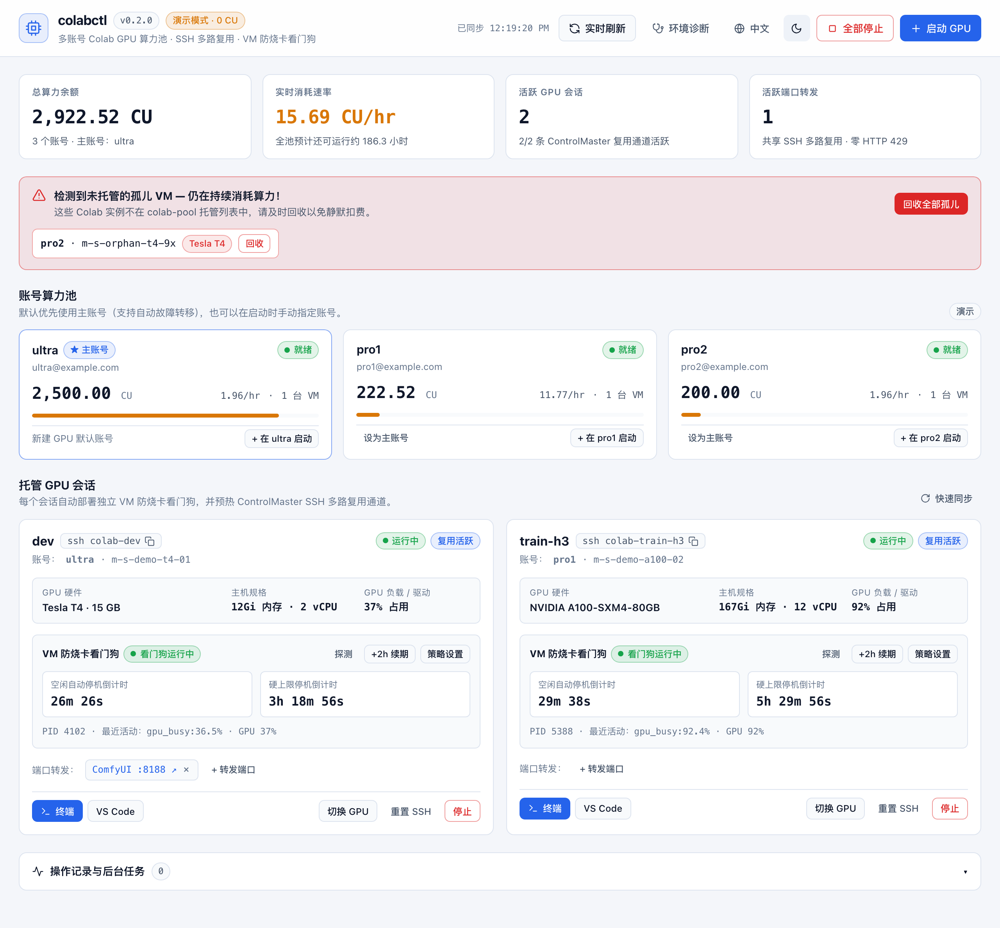
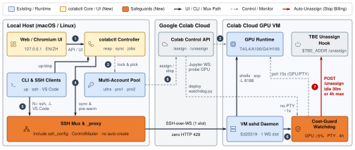
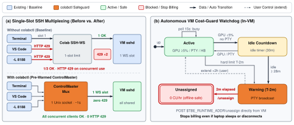
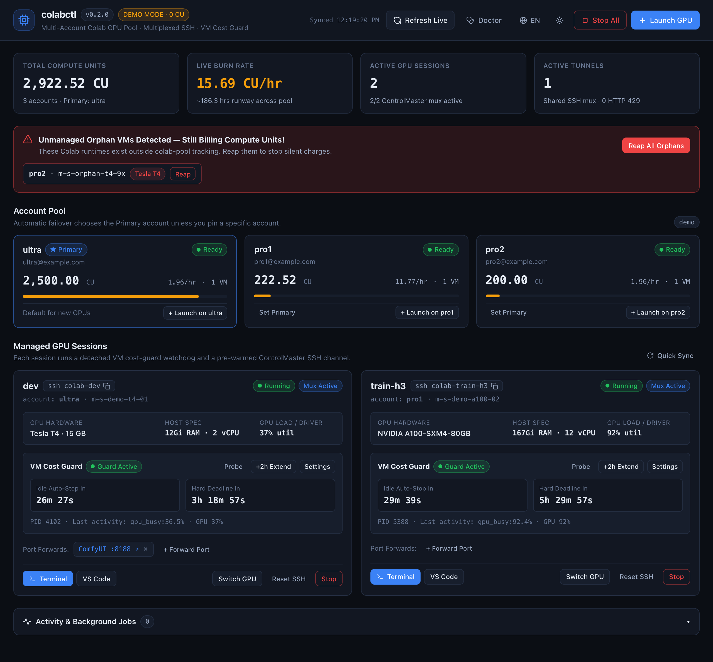
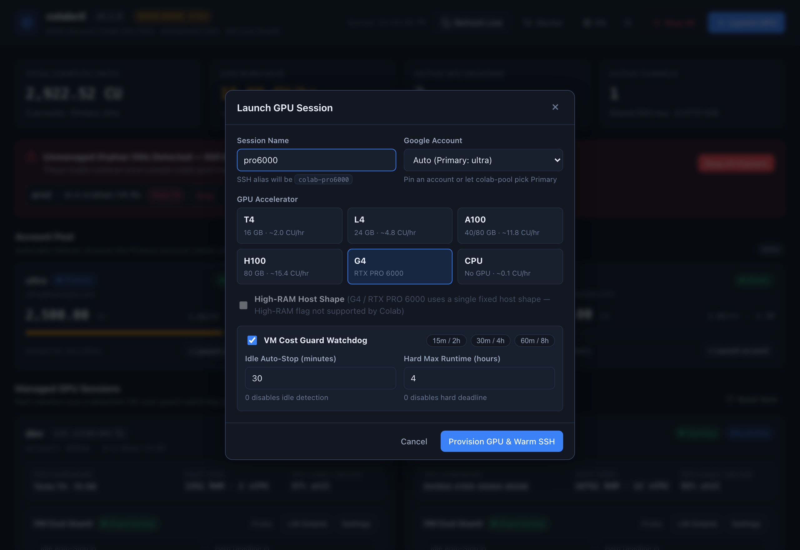

<div align="center">

# colabctl

**将多账号 Google Colab GPU 变成原生多路复用 SSH 工作站 —— 告别 `HTTP 429` 与静默烧算力**

[](pyproject.toml)
[](src/colabctl/__init__.py)
[](LICENSE)
[](https://github.com/yunzinan/colabctl/actions/workflows/ci.yml)
[](#本地管理面板colabctl-ui)
[](README.md)

[English](README.md) | **简体中文**

</div>

---

`colabctl` 是基于 Google 官方 [`google-colab-cli`](https://github.com/googlecolab/google-colab-cli) 与 [`colab-account-changer`](https://github.com/mizorewww/colab-account-changer) 构建的**多账号 Google Colab GPU 自动化调度器、原生多路复用 SSH 管理器、VM 端防烧额度看门狗，以及本地 Chromium App / Web 管理面板**。

无需再忍受 Colab 浏览器标签页断连、不用再折腾脆弱的 `cloudflared` / `ngrok` 穿透、不再因多开终端或 VS Code 撞上 `HTTP 429`，更不用担心电脑合盖睡觉后 GPU 在云端偷偷烧光 Compute Units。无论是 **T4、L4、A100、H100 还是 RTX PRO 6000（G4）**，一条命令或一次点击即可秒级就绪。

<div align="center">
  
  <br />
  <sub><b>colabctl 本地算力控制面板</b> —— 多账号 Compute Units 算力池、孤儿 VM 计费告警、每秒跳动的 VM 看门狗倒计时、共享通道端口转发。支持 <code>colabctl ui --demo</code> 零消耗安全体验（不花 1 分算力）。</sub>
</div>

---

## 为什么选择 `colabctl`？

| 能力对比 | Colab 网页端 | 原生 `google-colab-cli` | **`colabctl`** |
| :--- | :---: | :---: | :---: |
| 零浏览器按需申请 GPU（`T4` / `L4` / `A100` / `H100` / `G4`） | ❌ | ✅ | ✅ |
| 多账号 Compute Units 算力池、余额监控与主账号自动故障转移 | ❌ | ❌ | ✅ |
| 多终端 + VS Code Remote-SSH + `-L` 端口转发并发使用 | ❌ | ❌ *（撞单槽报 `HTTP 429`）* | ✅ *（单条预热 `ControlMaster`）* |
| **电脑合盖 / 断网后依然自动停机止损** | ❌ *（依赖浏览器）* | ❌ | ✅ *（VM 内直调 `$TBE_ADDR/unassign`）* |
| 最长运行硬上限 + 停机前终端广播提醒 + 一键 `+2h` 续期 | ❌ | ❌ | ✅ |
| 分配超时 / 503 失败后精准回收本次泄露的孤儿 VM（不误杀网页 Notebook） | ❌ | ❌ | ✅ |
| 防止对已停机别名执行 `ssh` 时悄悄拉起新的计费实例 | — | ❌ | ✅ *（`colabctl _proxy` 拦截）* |
| 单内存规格 GPU（`G4` / `L4`）自动防 `High-RAM` 触发 `HTTP 400` | — | 部分 *（仅 L4）* | ✅ *（G4 / L4 全链路保护）* |
| 本地独立桌面窗口 / Web 控制面板（**简体中文 / English**、深浅主题、`--demo`） | — | ❌ | ✅ |
| 全命令 `--json` 机器可读输出（适配脚本与 AI Coding Agent） | ❌ | 部分 | ✅ |

---

## 系统架构与核心机制

### 全栈系统架构

`colabctl` 在架构上将核心编排层（[`service.py`](src/colabctl/service.py)）与 CLI（[`cli.py`](src/colabctl/cli.py)）、本地 Web 控制面板（[`web/server.py`](src/colabctl/web/server.py)）彻底解耦，命令行与图形界面共享同一套状态、SSH 复用通道与安全边界：

<div align="center">
  
  <br />
  <sub><b>图 1.</b> <code>colabctl</code> 全栈架构与端到端工作流。高清文件下载：<a href="docs/figures/colabctl-workflow/fig.final.svg">SVG</a> · <a href="docs/figures/colabctl-workflow/fig.final.pdf">PDF</a> · <a href="docs/figures/colabctl-workflow/fig.png">PNG</a>。</sub>
</div>

### 两大核心保护机制原理

Google Colab 的原生 SSH-over-WebSocket 通道对每台 VM 仅开放 **1 个并发连接槽位**（第 2 个连接直接返回 `HTTP 429`）；同时，本机断网或休眠后云端 GPU 会持续扣费。`colabctl` 在协议层和 VM 内部彻底解决了这两个痛点：

<div align="center">
  
  <br />
  <sub><b>图 2.</b> <code>colabctl</code> 两大核心机制。<b>(a)</b> 通过预热单条 OpenSSH <code>ControlMaster</code> Unix Socket，将多终端、VS Code、<code>-L</code> 端口转发与无 PTY 探活全部复用到同一个 SSH-over-WS 槽位，实现零 <code>HTTP 429</code>。<b>(b)</b> 独立部署在 VM 内部的零依赖 Python 看门狗每 15 秒轮询 GPU 利用率（&lt;5%）、PTY 终端 I/O 与硬上限，到点前 2 分钟广播提醒（支持 <code>extend +2h</code> 续期），超时后直接调用 <code>$TBE_RUNTIME_ADDR/unassign</code> 自主停机。高清下载：<a href="docs/figures/colabctl-mechanisms/fig.final.svg">SVG</a> · <a href="docs/figures/colabctl-mechanisms/fig.final.pdf">PDF</a> · <a href="docs/figures/colabctl-mechanisms/fig.png">PNG</a>。</sub>
</div>

### 四重防烧 Compute Units 保护

1. **VM 端空闲自动停机看门狗**（默认 30 分钟）：独立运行在 Colab VM 内部，每 15 秒检测 `nvidia-smi` 利用率（`< 5%`）、`/dev/pts/*` 终端活动与心跳；达到空闲阈值后直接调用 `$TBE_RUNTIME_ADDR/unassign` 释放实例——**即使电脑合盖、休眠或断网依然有效**。
2. **VM 端硬性最长运行上限**（默认 4 小时）：即便训练脚本卡死占满 GPU，到达硬上限前 2 分钟仍会向所有活跃终端广播提醒，未续期则自动释放（随时可通过 `colabctl extend <name> --hours 2` 或界面 `+2h 续期` 延长）。
3. **禁止 `ssh` 隐式建机**：托管配置写入 `~/.config/colabctl/ssh_config`（仅在 `~/.ssh/config` 顶部无侵入加一行 `Include`），通过 `colabctl _proxy` 严格禁止对已停机会话执行 `ssh` 时意外拉起新计费实例。
4. **分配超时孤儿精准回收**：当 `colabctl up` 遇到上游超时或 `503` 失败时，自动比对申请前后的服务端实例列表，只清理**本次新泄露**的孤儿 VM，绝不误杀你在浏览器里自己打开的 Notebook。

---

## 本地管理面板（`colabctl ui`）

内置零外部 CDN 依赖（完全离线可用）的本地控制面板，自动检测本机 Chrome / Edge / Brave / Arc / Chromium 并以 `--app` 独立桌面应用窗口打开：

```bash
# 以独立 Chromium 桌面窗口启动管理面板（连接你的真实多账号算力池）
colabctl ui

# 零消耗安全预览模式（纯内存模拟数据，无需登录 Google、不花任何 Compute Units）
colabctl ui --demo

# 指定初始语言（默认 auto 自动匹配浏览器语言，界面右上角随时一键切换 中 / EN）
colabctl ui --lang zh
colabctl ui --lang en

# 在普通浏览器标签页打开，或仅启动本地服务不自动弹窗
colabctl ui --browser
colabctl ui --no-open --port 18420
```

<table>
  <tr>
    <td width="50%">
      
      <p align="center"><sub><b>深色 / 浅色主题 & 中英双语实时切换</b> —— 顶栏一键无刷新切换 <code>中文 / EN</code> 与深浅配色，本地持久化记忆，支持实时算力消耗与孤儿 VM 红色告警。</sub></p>
    </td>
    <td width="50%">
      
      <p align="center"><sub><b>智能建机弹窗</b> —— 支持 T4 / L4 / A100 / H100 / G4 (RTX PRO 6000) / CPU，自由指定账号与看门狗预设，选中 G4 / L4 自动禁用 <code>High-RAM</code> 避免触发 Colab <code>400</code> 报错。</sub></p>
    </td>
  </tr>
</table>

**管理面板核心亮点：**
- **一键直连开发**：一键唤起 macOS iTerm2 / Terminal.app 直连 GPU、一键打开 **VS Code Remote-SSH**（直达 `/content`）、复制 `ssh colab-<name>`、以及一键 `重置 SSH` 修复僵死会话导致的 429。
- **可视化 `-L` 端口转发**：内置 **ComfyUI (`8188`)**、**TensorBoard (`6006`)**、**Gradio (`7860`)**、**vLLM / API (`8000`)**、**Jupyter (`8888`)** 快捷预设，复用同一条 `ControlMaster` 通道且自动拦截 Colab 保留端口 `8080`。
- **本地回环安全边界**：仅绑定 `127.0.0.1`、强制校验回环 `Host` 头（防 DNS Rebinding）、每次启动生成随机一次性 Session Token（`X-Colabctl-Token` + `HttpOnly SameSite=Strict` Cookie，加载后自动擦除地址栏 token），且自带后端断连检测横幅，避免关闭终端后独立窗口一直假转圈。

---

## 快速上手（3 步）

### 1. 安装前置依赖并登录 Google 账号

> 需要 Python 3.12+，推荐使用 [`uv`](https://docs.astral.sh/uv/)。

```bash
# 安装 Google 官方 Colab CLI 与多账号池工具
uv tool install "google-colab-cli>=0.8.0"
uv tool install "git+https://github.com/mizorewww/colab-account-changer"

# 添加一个或多个 Google 账号（凭据保存在系统 Keychain 中）
colab-account add ultra
colab-account add pro1
colab-account list --usage
```

### 2. 安装 `colabctl`

```bash
git clone https://github.com/yunzinan/colabctl.git
cd colabctl
uv tool install -e .

# 环境自检（检查依赖、SSH 密钥、~/.ssh/config Include 与账号池）
colabctl doctor
```

> 如果还没有 Ed25519 SSH 密钥，可先生成一把：
> `ssh-keygen -t ed25519 -f ~/.ssh/id_ed25519_colab`

### 3. 启动你的第一台 GPU

```bash
# 方式 A：打开可视化桌面管理面板
colabctl ui

# 方式 B：命令行一键申请 T4（自动 30m 空闲停机 + 4h 硬上限 + 预热 SSH 复用通道）
colabctl up dev --gpu t4

# 任意多开终端、scp、VS Code Remote-SSH，全部零 HTTP 429
ssh colab-dev
```

---

## 支持的 GPU 型号

| `--gpu` 参数 | 显卡型号 | 常见显存 | 高内存主机（`--high-mem`） |
| :--- | :--- | :--- | :--- |
| `t4` | NVIDIA Tesla T4 | 16 GB | 支持 |
| `l4` | NVIDIA L4 | 24 GB | 单一固定规格（自动忽略） |
| `a100` | NVIDIA A100 | 40 / 80 GB | 支持（系统内存；显存取决于 Colab 实际分配） |
| `h100` | NVIDIA H100 | 80 GB | 支持 |
| `g4` | NVIDIA RTX PRO 6000 Blackwell | 96 GB | 单一固定规格（自动剥离，防止 Colab 报 `HTTP 400`） |
| `none` | 纯 CPU 运行时 | — | 支持 |

---

## 常用 CLI 命令速查

所有查询与生命周期命令均支持 `--json` 输出，便于脚本集成或交由 AI Agent 自动调用。

```bash
# --- 诊断与算力池总览 ---
colabctl doctor                                  # 本地环境自检
colabctl ls                                      # 缓存态总览 + 活跃会话 + 孤儿告警
colabctl ls --live --probe-guard                 # 拉取 Google 实时余额 + 探测 VM 实时看门狗倒计时
colabctl primary ultra --threshold 5             # 设置主账号与自动切换余额阈值

# --- 建机与换卡 ---
colabctl up dev --gpu t4                         # 默认 T4 + 30m 空闲自停 + 4h 硬上限
colabctl up pro6k --gpu g4 --account ultra       # 指定账号申请 RTX PRO 6000 (G4)
colabctl up train --gpu a100 --high-mem --max-hours 8 --connect
colabctl switch dev --gpu l4                     # 停旧机并换卡重建，保留同名 SSH 别名 colab-dev

# --- 多路复用 SSH 与端口转发（零 HTTP 429）---
ssh colab-dev                                    # 原生 OpenSSH 直连（复用预热 ControlMaster）
colabctl ssh dev                                 # 交互式 Shell
colabctl ssh dev -- nvidia-smi                   # 远端执行单条命令
colabctl tunnel dev 8188                         # 转发 VM :8188 -> 本机 127.0.0.1:8188（如 ComfyUI）
colabctl mount-drive dev                         # 在 VM 内挂载 Google Drive

# --- VM 看门狗管理与故障恢复 ---
colabctl status dev                              # 查看硬件规格、看门狗倒计时与 GPU 利用率
colabctl extend dev --hours 2                    # 硬上限续期 +2 小时并重置空闲计时
colabctl guard dev --idle-min 60 --max-hours 8   # 在线动态调整空闲阈值与硬上限
colabctl guard dev --off                         # 暂停自动停机保护
colabctl guard dev --on                          # 重新启用自动停机保护
colabctl reset-ssh dev                           # 清理远端僵死 sshd 会话并重新预热复用通道

# --- 停机与孤儿清理 ---
colabctl stop dev                                # 停止单个 VM、结束计费并移除 SSH 配置
colabctl stop --all                              # 一键停止所有账号下的全部 VM 和孤儿实例
colabctl reap --all-orphans                      # 回收所有未托管的孤儿 VM

# --- 本地管理面板 ---
colabctl ui                                      # 独立 Chromium 桌面窗口
colabctl ui --demo                               # 零消耗安全预览模式
colabctl ui --lang zh                            # 指定初始语言（auto | zh | en）
```

---

## 开发与测试

```bash
# 运行完整单元测试与 FastAPI 安全/生命周期集成测试（26 项）
uv run --extra dev pytest -v
```

### 目录结构

```text
src/colabctl/
├── cli.py                # Typer + Rich CLI 入口与 --json 机器输出
├── service.py            # 与界面解耦的核心 ColabController 编排层
├── models.py             # Pydantic 数据模型与单规格 GPU 归一化逻辑
├── pool_adapter.py       # colab-pool / colab-account / colab 结构化适配层
├── ssh_manager.py        # 托管 ~/.config/colabctl/ssh_config 与 ControlMaster 复用管理
├── watchdog_manager.py   # 基于无 PTY 复用通道 / Jupyter WS 的看门狗控制器
├── watchdog_script.py    # 零依赖 stdlib Python 看门狗脚本（独立部署于 Colab VM 内）
└── web/
    ├── server.py         # 仅绑定回环地址的 FastAPI 服务（Host + Session Token 校验）
    ├── jobs.py           # 后台异步建机/换卡/停机任务追踪器
    ├── tunnels.py        # 复用共享 SSH 通道的 -L 端口转发管理器
    ├── launcher.py       # Chromium --app 窗口与 macOS 终端 / VS Code 一键唤起器
    ├── demo.py           # 零消耗纯内存 DemoColabController
    └── static/           # 零外部依赖前端（index.html, app.js, i18n.js, styles.css）
tests/                    # 单元与 API 集成测试（看门狗状态机、SSH 复用、核心服务、CLI、Web 安全）
docs/
├── figures/              # 顶会论文级矢量架构图与机制图（SVG / PDF / PNG）
└── screenshots/          # 本地控制面板 2x 高分屏实机截图
```

---

## 致谢

本项目站在以下优秀开源项目的肩膀上构建：
- [`googlecolab/google-colab-cli`](https://github.com/googlecolab/google-colab-cli) — Google 官方 Colab 命令行与运行时/SSH 协议客户端。
- [`mizorewww/colab-account-changer`](https://github.com/mizorewww/colab-account-changer) — 多账号 Keychain 切换与 `colab-pool` 会话/孤儿追踪工具。

---

## 开源协议

本项目基于 [MIT License](LICENSE) 开源。
